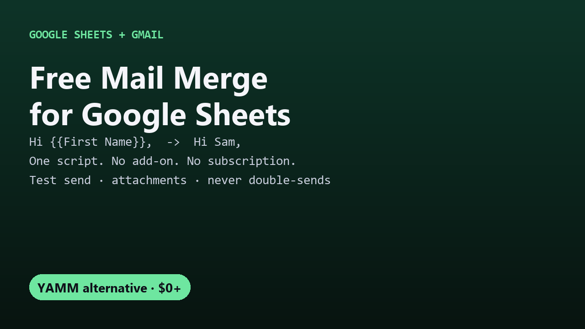

# Free Mail Merge for Google Sheets

Send a personalized Gmail to every row of a Google Sheet, using a Gmail draft as the template. One free Apps Script file, no add-on.

## Guides

- [How to mail merge in Google Sheets for free](free-mail-merge-google-sheets.html)
- [Mail merge with a different attachment for each person](mail-merge-with-attachments-google-sheets.html)
- [A free YAMM alternative (no 20-a-day cap)](free-yamm-alternative.html)
- [How to schedule a mail merge (send later)](schedule-mail-merge-google-sheets.html)
- [Follow up with people who didn't reply](mail-merge-follow-up-emails-google-sheets.html)
- [A GMass alternative with follow-ups, no subscription](gmass-alternative-google-sheets.html)

## Get it

The script and full instructions are on GitHub: [DecodedXR/sheets-mail-merge](https://github.com/DecodedXR/sheets-mail-merge). It's MIT licensed and free.

Need scheduled sends or automatic follow-ups? [Mail Merge Pro](https://decodedpc.gumroad.com/l/tcfsse) adds both for a one-time $12.
